# HackGrid — An Evidence-Grounded Jurisdiction-Aware Multi-Agent Framework

**HackGrid** is an evidence-first, jurisdiction-aware decision-intelligence framework designed to evaluate mission-critical technical, regulatory, and policy questions without ungrounded LLM hallucinations. Rather than functioning as a conversational chatbot, HackGrid operates as an institutional reasoning engine that strictly separates evidence retrieval from language-model synthesis, enforces deterministic regulatory jurisdiction profiles (India, European Union, International), extracts counter-evidence to challenge emerging hypotheses, deterministically evaluates evidence sufficiency, and gates consequential outcomes behind automated risk scoring and human authority governance.

---

### At a Glance

| Property | Value / Verification | Source Component |
|---|---|---|
| **Architecture** | Evidence-Grounded Multi-Agent Decision Intelligence | `Backend/orchestrator.py`, `rag/orchestrator.py` |
| **Embedding Model** | `BAAI/bge-m3` (Dense 1,024-dimensional vectors) | `rag/retrieval.py`, `rag/gptoss_backend.py` |
| **Vector Search Engine** | FAISS (`IndexFlatIP` cosine similarity) | `rag/faiss_new.index` |
| **Reasoning & Synthesis Model** | `openai/gpt-oss-120b` via Groq LPU API | `Backend/final_synthesis.py`, `rag/gptoss_backend.py` |
| **Validated Knowledge Base** | 14,143 indexed regulatory and technical chunks | `rag/chunks_new.json` (72 verified source documents) |
| **Active Jurisdictions** | India, European Union, International / Standards | `rag/retrieval.py` (`JURISDICTION_PROFILES`) |
| **Reranking Engine** | `BAAI/bge-reranker-v2-m3` with similarity score fallback | `Backend/evidence_reranking/reranker.py` |
| **Evidence Engine** | Deterministic role classification & sufficiency verification | `Backend/evidence_engine/engine.py` |
| **Absence Protocol** | Conservative `ABSENCE_NOT_ESTABLISHED` safeguard | `Backend/evidence_engine/absence_protocol.py` |
| **Risk & Authority Engine** | Deterministic 4-tier escalation (`AUTO` to `SENIOR_AUTHORITY`) | `Backend/risk_engine/engine.py` |
| **Provenance Model** | Bidirectional Claim-to-Evidence attribution (`CLAIM-xxx` → `EV-xxx`) | `Backend/evidence_engine/claim_builder.py` |
| **Governance Trail** | Immutable, append-only JSONL ledger (`audit.jsonl`) | `Backend/audit/recorder.py`, `Backend/audit_api.py` |
| **API Framework** | FastAPI (RESTful JSON API with CORS on Port 8000) | `Backend/server.py` |
| **Web Console** | Single-page vanilla CSS/JS dark glassmorphic investigation console | `Frontend/index.html` (Port 5500) |

---

## 1. Overview

HackGrid was created to solve a fundamental failure mode in high-stakes technological governance: applying generative artificial intelligence directly to regulatory and technical compliance queries produces authoritative-sounding hallucinations, conflates distinct legal jurisdictions, mistakes retrieval failures for evidence of regulatory absence, and authorizes decisions without auditable accountability.

HackGrid serves compliance officers, telecommunication engineers, defence system architects, maritime safety analysts, and policy researchers who require mathematically traceable answers grounded in binding statutory rules, technical standards, and institutional frameworks.

### Decision-Support Philosophy
HackGrid strictly upholds three foundational tenets:
1. **Evidence First**: No claim may be asserted without verified, chunk-level provenance anchored in primary technical specifications or statutory gazettes.
2. **Reasoning Second**: Generative language models reason *over* structured, classified evidence pools rather than acting as parametric knowledge stores.
3. **Decision Authority Last**: AI systems cannot unilaterally authorize high-consequence compliance actions; authority requirements are deterministically calculated and escalated to authenticated human reviewers.

---

## 2. The Problem

Conventional Large Language Model (LLM) applications and standard Retrieval-Augmented Generation (RAG) pipelines fail catastrophically in regulated domains:

```
[ Conventional Chatbot / Vanilla RAG ]
Query ──► Unfiltered Search ──► Top-K Chunks ──► LLM ──► Uncalibrated Text
                                                    ▲
               Hallucinations, Missing Citations, ──┘
               Jurisdiction Collisions, Ignored Contradictions
```

1. **Hallucination and Unsupported Assertions**: Standard LLMs hallucinate plausible regulatory clauses, standard numbers (e.g., citing non-existent 3GPP releases), and compliance timelines when context is sparse.
2. **Jurisdiction Blindness**: A query concerning Indian telecom licensing may retrieve EU GDPR or NIS2 directives and seamlessly blend them into Indian Department of Telecommunications (DoT) mandates without boundary enforcement.
3. **Retrieval Incompleteness & Confirmation Bias**: Standard top-$K$ semantic similarity retrieves only texts that mirror the prompt's phrasing, ignoring contradictory caveats, exceptions, or limiting amendments.
4. **Failure to Distinguish Absence of Evidence from Evidence of Absence**: When a standard RAG system finds no document mentioning a restriction, it frequently declares: *"There is no regulation governing this activity."* In law and safety engineering, **absence of retrieved text does not establish absence of a legal requirement**.
5. **Lack of Governance & Authority**: Vanilla pipelines produce the same confident response regardless of whether the operational impact is a routine query or a critical security breach requiring national authority notification.

---

## 3. HackGrid's Core Idea

HackGrid resolves these vulnerabilities by enforcing a clean, multi-layered architectural boundary:

```
┌────────────────────────────────────────────────────────┐
│                   RETRIEVAL LAYER                      │
│   Semantic Search (BGE-M3) + Jurisdiction Filtering    │
└──────────────────────────┬─────────────────────────────┘
                           ▼
┌────────────────────────────────────────────────────────┐
│               EVIDENCE ANALYSIS LAYER                  │
│   Reranking, Counter-Evidence & Role Classification    │
└──────────────────────────┬─────────────────────────────┘
                           ▼
┌────────────────────────────────────────────────────────┐
│                   REASONING LAYER                      │
│   Specialist Multi-Agent Analysis & GPT-OSS Synthesis   │
└──────────────────────────┬─────────────────────────────┘
                           ▼
┌────────────────────────────────────────────────────────┐
│               GOVERNANCE & AUDIT LAYER                 │
│  Deterministic Risk Engine & Append-Only Audit Ledger  │
└────────────────────────────────────────────────────────┘
```

By decoupling retrieval, evidence validation, model reasoning, and governance escalation, HackGrid guarantees that generative synthesis cannot bypass institutional compliance policies.

---

## 4. Key Contributions / Architectural Novelty

### 1. Jurisdiction-Aware Candidate Expansion & Filtering
* **Problem**: Regulatory mandates conflict across geographic borders.
* **Mechanism**: In `rag/retrieval.py`, candidate retrieval expands candidate depth ($10 \times K$, minimum 100 candidates) against the 14,143-chunk FAISS index, then deterministically prunes records according to `JURISDICTION_PROFILES` (`India` allows `India` + `International`; `European Union` allows `European Union` + `International`).
* **Implementation**: `rag/retrieval.py:126-245`.

### 2. Active Counter-Evidence Retrieval & Contradiction Discovery
* **Problem**: Standard semantic search yields confirmation bias.
* **Mechanism**: In `Backend/evidence_reranking/counter_evidence.py`, HackGrid constructs counter-queries containing qualifying and exception terms (`"contrary"`, `"exception"`, `"limitation"`, `"inconsistent"`), executes targeted retrieval, scores counter-signals, and merges counter-evidence into the candidate set.
* **Implementation**: `Backend/evidence_reranking/counter_evidence.py:30-85`.

### 3. Four-Tier Evidence Role Classification
* **Problem**: LLMs treat all retrieved snippets as undifferentiated affirmative facts.
* **Mechanism**: Every piece of retrieved evidence is categorized into one of four roles:
  * `SUPPORTING`: Directly establishes a statutory or technical requirement.
  * `CONTRADICTING`: Refutes, restricts, or conflicts with the hypothesis.
  * `LIMITING`: Imposes boundary conditions, exemptions, or scope ceilings.
  * `CONTEXTUAL`: Provides background, definitions, or architectural framing.
* **Implementation**: `Backend/evidence_engine/models.py:20-65`, `Backend/evidence_engine/llm_classifier.py`.

### 4. Conservative Absence Verification Protocol
* **Problem**: Search misses are misdiagnosed as regulatory vacuums.
* **Mechanism**: `Backend/evidence_engine/absence_protocol.py` intercepts claims asserting non-existence. If authoritative registries were not exhaustively queried, it forces the verdict to `ABSENCE_NOT_ESTABLISHED`.
* **Implementation**: `Backend/evidence_engine/absence_protocol.py:18-95`.

### 5. Deterministic Risk & Authority Engine
* **Problem**: Language models unpredictably judge their own decision safety.
* **Mechanism**: `Backend/risk_engine/engine.py` applies deterministic scoring based on decision consequence, external actions, and evidence sufficiency, outputting escalation levels (`AUTO_RESPONSE`, `ANALYST_REVIEW`, `DOMAIN_EXPERT`, `SENIOR_AUTHORITY`) that cannot be lowered by the generative model.
* **Implementation**: `Backend/risk_engine/rules.py`, `Backend/governance.py`.

### 6. Bidirectional Claim-to-Evidence Traceability
* **Problem**: End-users cannot verify which exact paragraphs generated an executive summary.
* **Mechanism**: Final synthesis structures assertions as explicit claims (`CLAIM-001`, `CLAIM-002`) mapped to evidence identifiers (`EV-001`, `EV-003`). The frontend console hyper-links claims directly to the source chunk cards.
* **Implementation**: `Backend/evidence_engine/claim_builder.py`, `Frontend/index.html`.

---

## 5. System Architecture

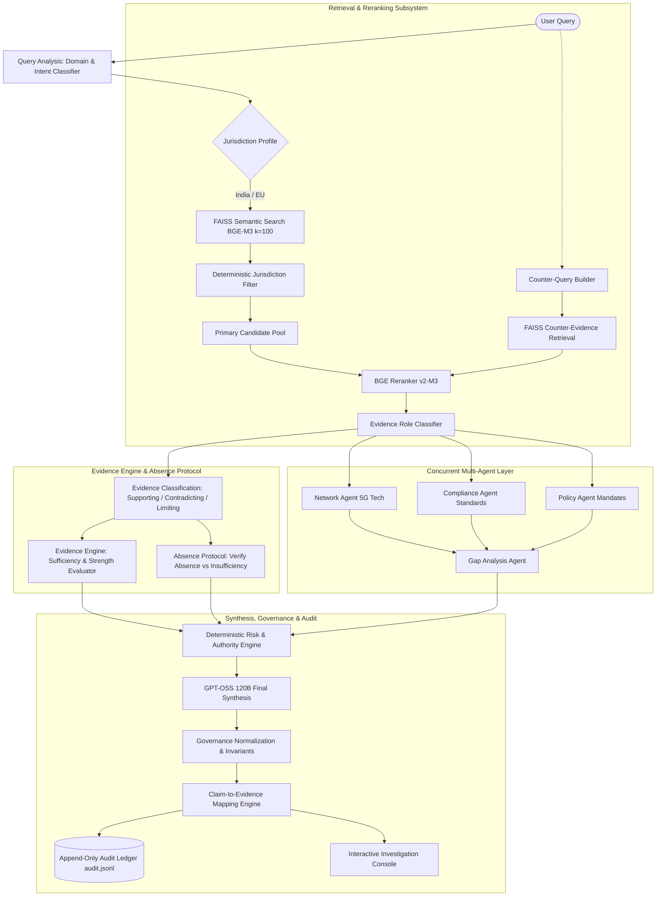

---

## 6. End-to-End Execution Flow

When a user submits a query via `POST /api/query` or runs a scenario step via `POST /api/scenarios/run`, the execution traverses ten sequential stages in `Backend/orchestrator.py`:

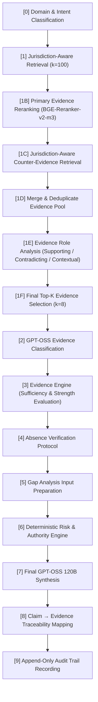

### Detailed Pipeline Stages

| Stage | Name | Purpose | Model / Tool | Primary Outputs |
|---|---|---|---|---|
| **[0]** | Domain & Intent Classification | Categorize query into 7 domains and 8 intent classes | Regex & Lexical Matching | `domain`, `intent`, `response_profile` |
| **[1]** | Jurisdiction-Aware Retrieval | Retrieve broad candidate vectors with geographic profile gating | BAAI/bge-m3 + FAISS | Candidate chunks ($K \ge 100$) |
| **[1B]** | Primary Reranking | Re-score semantic candidates by relevance | BAAI/bge-reranker-v2-m3 | Ranked primary candidates |
| **[1C]** | Counter-Evidence Retrieval | Execute transformed counter-queries to detect conflicting terms | FAISS + Counter Lexicon | Counter-evidence candidates |
| **[1D]** | Evidence Merging | Deduplicate primary and counter-evidence | Hash & Chunk ID match | Merged candidate pool |
| **[1E]** | Evidence Role Analysis | Identify linguistic markers for support, contradiction, context | Lexicon Analysis | Role classifications |
| **[1F]** | Final Top-K Selection | Constrain evidence payload to optimal reasoning window | Deterministic Selector | Final Top-8 Evidence Records |
| **[2]** | Structured Classification | Extract requirements, strength, and applicability | `openai/gpt-oss-120b` | `EvidenceClassification` JSON |
| **[3]** | Evidence Engine | Calculate mathematical sufficiency and source diversity | `EvidenceEngine` | `overall_status`, `overall_strength` |
| **[4]** | Absence Verification | Guard against assuming missing text equals legal non-existence | `AbsenceProtocol` | `ABSENCE_NOT_ESTABLISHED` verdict |
| **[5]** | Gap Analysis | Evaluate technical coverage vs missing regulatory clarity | `GapAdapter` | `verdict`, `identified_gaps` |
| **[6]** | Risk & Governance | Calculate consequence score and authority escalation level | `RiskEngine` | `risk_level`, `escalation_level`, `human_review_required` |
| **[7]** | Final Synthesis | Synthesize claims, technical and regulatory implications | `openai/gpt-oss-120b` | Executive Assessment & Claims |
| **[8]** | Claim Mapping | Bind individual assertions to chunk IDs (`EV-001`, etc.) | `ClaimBuilder` | `claim_evidence_mappings` |
| **[9]** | Audit Ledger | Persist unflattened provenance record to disk | `AuditRecorder` | Unique `audit_id` (e.g., `AUD-7881c...`) |

---

## 7. Query Understanding

The query classification subsystem in `Backend/query_analysis/domain_classifier.py` runs before retrieval to configure the optimal retrieval profile.

### Supported Domains (7)
1. **Maritime**: Vessel monitoring, AIS, GNSS anomalies, IMO conventions, port security.
2. **Telecom/5G**: Network slicing, 3GPP Rel 18/19, Open RAN, 5G Core (AMF, UPF, SMF), TEC GRs.
3. **Defence**: Tactical datalinks, UAV regulations, NATO CONEMP, military frequency bands.
4. **Policy/Compliance**: DoT rules, TRAI regulations, DPDP Act 2023/2025, MTCTE lab procedures.
5. **Research**: Academic 6G visions, O-RAN security papers, ITU-T Y.3172/3174 machine learning.
6. **Enterprise Incident**: Infrastructure cyber incidents, ransomware, lawful interception breaches.
7. **General Evidence**: Cross-domain technical inquiries without specialized domain signals.

### Supported Intents (8)
`Incident Analysis` • `Threat Analysis` • `Root Cause Analysis` • `Compliance` • `Policy Gap` • `Research Gap` • `Evidence Assessment` • `General Analysis`

### Example Classification
```json
{
  "query": "What security requirements apply to 5G network slicing in India?",
  "domain": "Telecom/5G",
  "domain_confidence": 0.875,
  "intent": "Compliance",
  "intent_confidence": 0.750,
  "response_profile": "Standard Compliance Profile",
  "classifier_version": "domain-intent-classifier-v1"
}
```

---

## 8. Retrieval Architecture

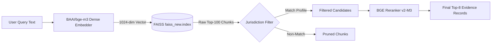

### Technical Specification
* **Model**: `BAAI/bge-m3` loaded via `sentence-transformers` on CPU/device.
* **Embeddings File**: `rag/embeddings_new.npy` (57.9 MB, 14,143 vectors $\times$ 1,024 float32).
* **Index File**: `rag/faiss_new.index` (57.9 MB, `IndexFlatIP` inner product on L2-normalized vectors).
* **Dynamic Candidate Expansion**: To prevent false negatives during geographic filtering, FAISS retrieves $\max(K \times 10, 100)$ candidates before pruning.

---

## 9. Knowledge Base Architecture

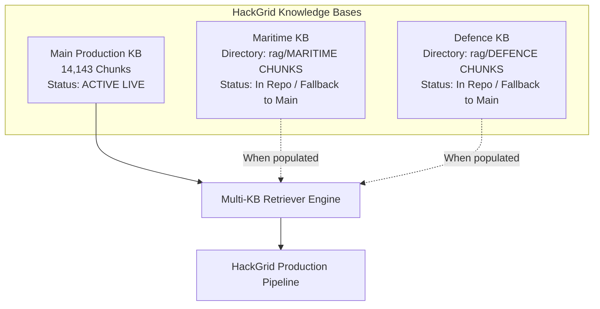

### Knowledge Base Inventory

| Knowledge Base | Chunks | FAISS Index | Chunk File | Live Pipeline Status |
|---|---|---|---|---|
| **Main KB** | **14,143** | `rag/faiss_new.index` | `rag/chunks_new.json` | **ACTIVE (Canonical Production Knowledge Base)** |
| **Maritime KB** | 0 | `rag/MARITIME CHUNKS/` | `maritime_chunks.json` | *Available in repository; falls back to Main KB in live retrieval* |
| **Defence KB** | 0 | `rag/DEFENCE CHUNKS/` | `defence_chunks.json` | *Available in repository; falls back to Main KB in live retrieval* |

> [!NOTE]
> `rag/multi_kb_retriever.py` provides multi-index federation logic. If domain indices are empty or unbuilt, the system deterministically executes retrieval against the Main KB (which already contains extensive maritime, defence, telecom, and statutory documents).

---

## 10. Knowledge Base Data Model

Every chunk in `rag/chunks_new.json` adheres to a strict JSON structure:

```json
{
  "text": "ETSI TS 123 501 V18.10.0 (2025-07) 5G; System architecture for the 5G System (5GS)...",
  "metadata": {
    "document": "23 Version 3gpp",
    "source_file": "3gpp\\23 Version 3gpp.pdf",
    "folder": "3gpp",
    "jurisdiction": "International",
    "document_type": "PDF",
    "page": 1,
    "chunk_id": "kb-000001",
    "language": "English",
    "text_hash": "a23f195d635e9561f4f52c1ad7f339b2301afe60aa2bd89df5e84b8a453db8fc"
  }
}
```

### Chunk Corpus Breakdown (14,143 Chunks Total)

* **By Regulatory Category**:
  * `3gpp` (Technical Specifications): 6,032 chunks
  * `DoT_Rules` (Indian Department of Telecommunications): 2,561 chunks
  * `EU Rules` (European Union Directives & Regulations): 1,364 chunks
  * `TRAI_Act` (Telecom Regulatory Authority of India): 1,222 chunks
  * `General` (Foundational Technical Papers & RFCs): 915 chunks
  * `TEC Guidelines` (Telecommunication Engineering Centre): 650 chunks
  * `Indian_Acts` (Information Technology & Telecommunications Acts): 498 chunks
  * `MTCTE Regulations` (Mandatory Testing & Certification): 452 chunks
  * `ITU_Rules_Framework` (International Telecommunication Union): 322 chunks
  * `DPDP Acts` (Digital Personal Data Protection Act): 127 chunks
* **By Jurisdiction Distribution**:
  * `International`: 6,354 chunks
  * `India`: 5,510 chunks
  * `European Union`: 1,364 chunks
  * `International / Other`: 915 chunks

---

## 11. Documents / Standards / Regulatory Sources

A representative audit of verified documents in `knowledge_base/Documents main/` and `rag/chunks_new.json`:

| Document / Standard | Issuer / Authority | Domain | Jurisdiction | Role in HackGrid |
|---|---|---|---|---|
| **3GPP TS 23.501 (Release 18/19)** | 3GPP / ETSI | Telecom/5G | International | Defines 5G system architecture and network slicing models |
| **ETSI TS 33.501 (Rel 18)** | ETSI | Telecom/5G | International | Security architecture and lawful interception standards for 5GS |
| **Telecommunications Act 2023** | Ministry of Communications, India | Policy/Compliance | India | Primary statutory framework governing Indian networks |
| **Critical Telecom Infrastructure Rules 2024** | DoT, India | Telecom/5G | India | Mandatory security obligations for core telecom assets |
| **Lawful Interception of Messages Rules 2024** | DoT / MHA, India | Telecom/5G | India | Technical and operational safeguards for intercepted streams |
| **TEC Standard for 5G Core (22160:2023)** | TEC, India | Telecom/5G | India | Technical testing criteria for core network elements in India |
| **TEC GR for gNodeB & Open RAN (2024)** | TEC, India | Telecom/5G | India | Mandatory generic requirements for radio and baseband units |
| **MTCTE Testing Procedures (2025/2026)** | TEC / DoT, India | Compliance | India | Mandatory security and interface certification protocols |
| **TRAI TCCPR & Telecom Regulations** | TRAI, India | Policy/Compliance | India | Consumer protection, spam regulation, and tariff governance |
| **DPDP Act 2023 & Rules 2025** | MeitY, India | Privacy/Compliance | India | Personal data fiduciary duties, processing consents, breaches |
| **IT Act 2000 (as amended)** | MeitY, India | Cybersecurity | India | Cyber offences, CERT-In reporting obligations, intermediary rules |
| **Directive (EU) 2022/2555 (NIS2)** | European Parliament / Council | Cybersecurity | European Union | Critical infrastructure cybersecurity risk management obligations |
| **Regulation (EU) 2024/1689 (EU AI Act)** | European Union | AI Governance | European Union | High-risk AI system conformity assessments and prohibitions |
| **Regulation (EU) 2016/679 (GDPR)** | European Union | Privacy | European Union | Cross-border data transfers and data protection safeguards |
| **ITU-T Y.3172 & Y.3174 Frameworks** | ITU-T | Research/Telecom | International | Architectural framework for machine learning in future networks |
| **Bharat 6G Vision Document** | DoT, India | Research | India | Strategic roadmap for terahertz communication and native AI |
| **IMO MSC.570(109) & A.1106(29)** | International Maritime Org | Maritime | International | Operational guidelines for Automatic Identification Systems (AIS) |
| **DRDO ToT Policy 2025 & Drone Rules 2021** | MoD / DGCA, India | Defence | India | Transfer of military technology and UAV operational airspace |

---

## 12. Evidence Architecture

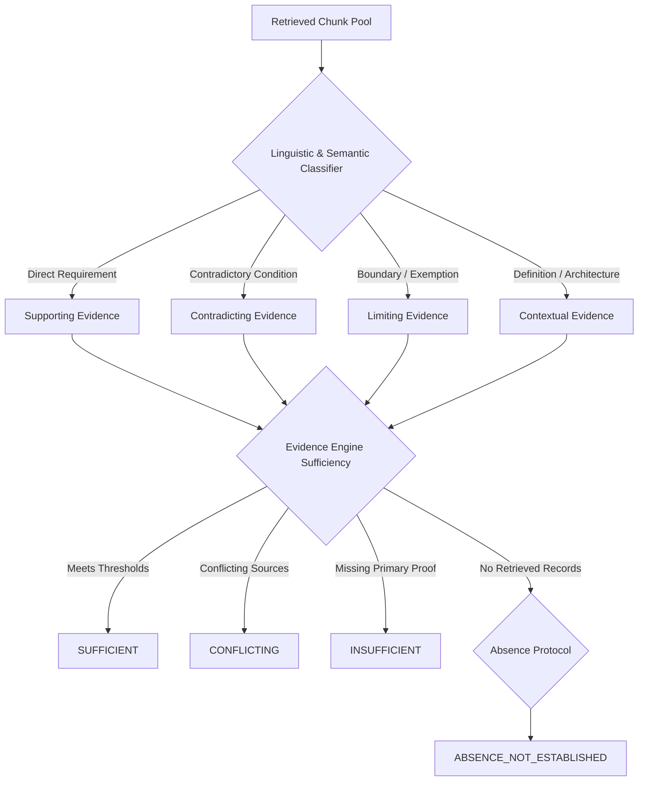

### The Analytical Trap: Absence of Evidence vs. Evidence of Absence
In legal and technical intelligence, **"I did not find a regulation" is NOT equivalent to "no regulation exists."**
A search miss can occur because:
1. The search query omitted an administrative synonym.
2. The regulation is in a non-indexed amendment.
3. The power resides in executive circulars rather than primary statutes.

HackGrid's Evidence Engine explicitly separates:
* **Negative Evidence**: An authoritative statute explicitly stating that an obligation does *not* apply to a specific entity.
* **Evidence Gap**: The system searched its knowledge base and located zero authoritative records. HackGrid flags this as an unverified gap, actively preventing false negative conclusions.

---

## 13. Counter-Evidence Architecture

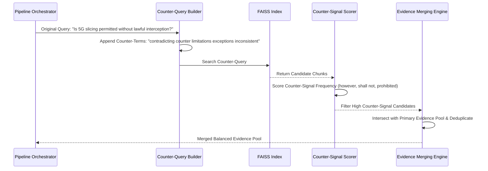

---

## 14. Evidence Sufficiency

The `EvidenceEngine` (`Backend/evidence_engine/engine.py`) determines whether the assembled evidence warrants drawing a conclusion.

### Mathematical Sufficiency Criteria
* **Status Enum**: `SUFFICIENT`, `INSUFFICIENT`, `CONFLICTING`, `PARTIALLY_ESTABLISHED`, `AMBIGUOUS`.
* **Strength Enum**: `STRONG`, `MODERATE`, `WEAK`, `INSUFFICIENT`.
* **Logic**:
  * If `contradicting_count > 0` and `supporting_count > 0` $\rightarrow$ `Status = CONFLICTING`.
  * If `primary_source_count == 0` or average confidence $< 0.5$ $\rightarrow$ `Strength = WEAK` or `Status = INSUFFICIENT`.
  * If `missing_evidence` is non-empty $\rightarrow$ Gaps are passed forward to the Gap Analysis adapter.

---

## 15. Absence Verification

The `AbsenceProtocol` (`Backend/evidence_engine/absence_protocol.py`) enforces strict epistemic humility:

```python
# Core Invariant from Backend/evidence_engine/absence_protocol.py
if not positive_evidence and not negative_evidence:
    # Zero evidence found across scope
    verdict = "ABSENCE_NOT_ESTABLISHED"
    confidence = 0.20
    notes.append("Failure to retrieve records does NOT establish regulatory non-existence.")
```

When triggered, the system injects a mandatory warning into the final synthesis:
> `[ABSENCE NOT ESTABLISHED]` *The knowledge base contains no positive records for this requirement. This cannot be interpreted as regulatory exemption. Independent statutory consultation is mandatory.*

---

## 16. Multi-Agent Architecture

HackGrid includes a specialized multi-agent layer (`rag/orchestrator.py`) where domain agents analyze queries from distinct perspectives.

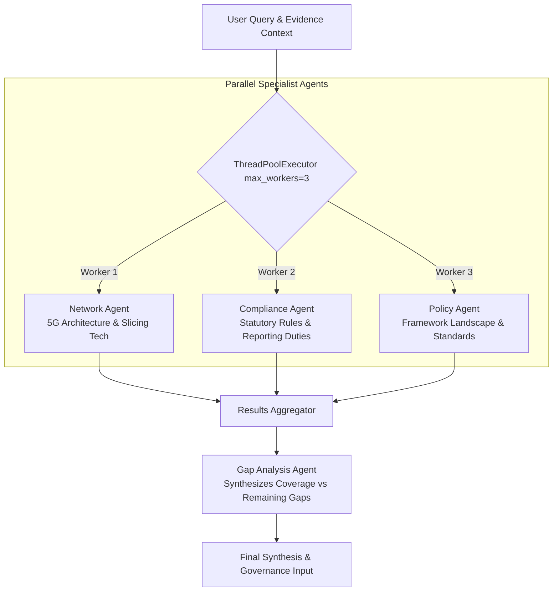

### Agent Responsibilities & Concurrency
1. **Network Agent** (`rag/network_agent.py`): Examines slicing dependencies, failure points, and technical architecture. Strictly barred from inventing regulations.
2. **Compliance Agent** (`rag/compliance_agent.py`): Retrieves $k=5$ regulatory chunks and evaluates explicit compliance duties.
3. **Policy Agent** (`rag/policy_agent.py`): Retrieves $k=6$ policy chunks and examines broad framework coverage.
4. **Concurrency Model**: Network, Compliance, and Policy execute concurrently using Python's `ThreadPoolExecutor(max_workers=3)`.
5. **Gap Analysis Agent** (`rag/gap_analysis_agent.py`): Runs sequentially *after* the parallel specialists finish, receiving all three outputs to detect coverage gaps.

---

## 17. Gap Analysis

The Gap Analysis engine (`Backend/evidence_engine/gap_adapter.py`) receives specialist outputs and structural evidence assessments:
* Evaluates whether the identified gap is an **Established Gap** (verified absence of standard), a **Potential Gap** (unclear mapping), or an **Artifact of Insufficient Evidence**.
* Formulates structured gap summaries ingested by the final synthesis layer.

---

## 18. GPT-OSS Reasoning Layer

HackGrid uses `openai/gpt-oss-120b` hosted on the ultra-low-latency Groq LPU inference engine (`rag/gptoss_backend.py`, `Backend/final_synthesis.py`).

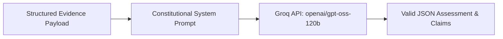

* **Model**: `openai/gpt-oss-120b`
* **Inference Provider**: Groq
* **Sampling Parameters**: `temperature = 0.2`, `reasoning_effort = "low"`, `max_tokens = 3000`
* **Role Distinction**: The language model is **never** used as a retrieval store. It functions solely as a structured reasoning engine evaluating retrieved context.

---

## 19. Risk & Governance / Human Review

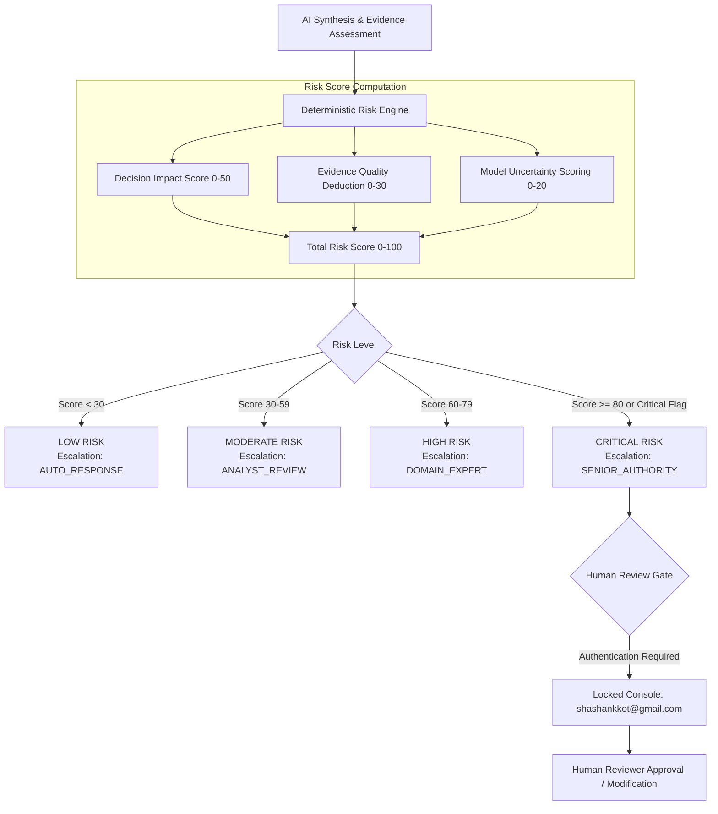

### Deterministic Risk Invariants
* The LLM cannot override, lower, or modify calculated risk levels.
* Consequential actions (e.g., shutting down a core network slice, issuing regulatory non-compliance notices) automatically escalate to `SENIOR_AUTHORITY`.
* If `human_review_required: true`, the frontend blocks automatic finalization and flags `AUTHENTICATION REQUIRED`.

---

## 20. Confidence Model

HackGrid rigorously separates model calibration from empirical proof:

| Dimension | Definition | Measured By | Can It Authorize Decisions? |
|---|---|---|---|
| **AI / Model Confidence** | LLM self-assessed probability of linguistic coherence | Logits / Self-report | **NO** (Never authoritative) |
| **Evidence Confidence / Quality** | Density, provenance, and authority of source chunks | Primary source ratio & absence score | **NO** (Informs risk engine) |
| **Decision Authority** | Institutional mandate required to execute the action | Deterministic Risk Engine | **YES** (Only when escalated to authorized humans) |

---

## 21. Claim → Evidence Mapping

Every finding generated by the final synthesis is decomposed into atomic claims linked to evidence identifiers:

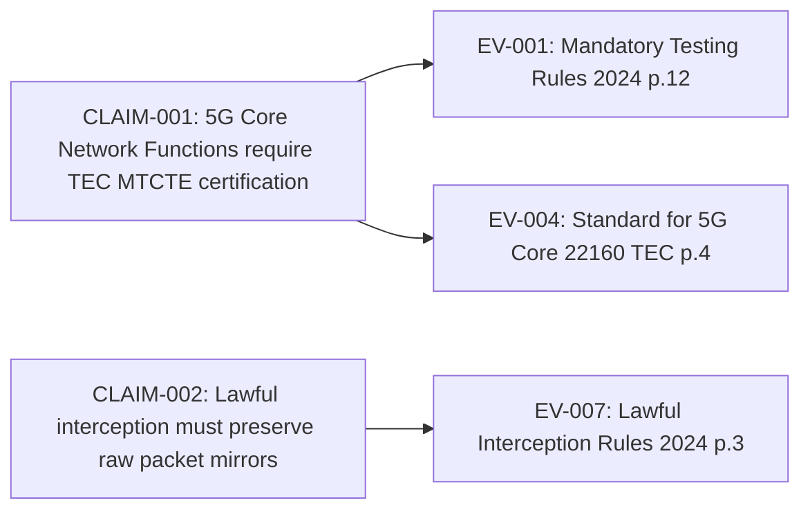

* In the Frontend Audit Console, clicking any evidence link (`EV-001`) smoothly scrolls to and highlights the source evidence card.

---

## 22. Audit Trail

Every transaction through HackGrid generates an immutable record stored in `Backend/audit/records/audit.jsonl`.
* **Identifier**: `audit_id` (e.g., `AUD-de618a32239f7b1ddb664d30`).
* **Storage**: Local append-only JSONL file.
* **Fields Preserved**: Timestamp, question, pipeline version, model, raw retrieved evidence, classifications, gap analysis, risk scores, claim mappings, reviewer notes, and human sign-off status.
* **API Access**: `GET /api/audits` (ledger summaries & metrics) and `GET /api/audits/{audit_id}` (full unflattened provenance record).

---

## 23. Complete Technology Stack

| Layer | Technology | Version | Purpose in HackGrid |
|---|---|---|---|
| **Core Runtime** | Python | 3.10 / 3.13 | Backend runtime & asynchronous service execution |
| **API Framework** | FastAPI | 0.142.2 | High-performance RESTful API with Pydantic validation |
| **ASGI Server** | Uvicorn | 0.54.0 | ASGI web server hosting FastAPI on `127.0.0.1:8000` |
| **Dense Embeddings** | `sentence-transformers` | 6.1.0 | Loads `BAAI/bge-m3` embedding model |
| **Vector Database** | `faiss-cpu` | 1.15.1 | In-memory similarity search over 14,143 vectors |
| **Reranker** | `FlagEmbedding` | 1.4.2 | `BAAI/bge-reranker-v2-m3` cross-encoder reranking |
| **LLM Provider** | Groq SDK | 1.7.0 | High-speed LPU inference client |
| **Generative Model** | `openai/gpt-oss-120b` | Latest | Reasoning, classification, and final assessment synthesis |
| **Data Validation** | Pydantic | 2.13.5 | Strict schema contracts for requests, evidence, and audit |
| **Web Frontend** | Vanilla HTML5 / CSS3 / JS | Standards | Single-file, zero-dependency, ultra-fast web interface |
| **Typography** | Manrope Font | Google Fonts | High-legibility technical interface typography |
| **Evaluation** | Pytest | 9.1.1 | Test suite covering governance invariants & pipeline |

---

## 24. Component-to-File Mapping

| System Layer | Component | Source File(s) | Key Responsibilities |
|---|---|---|---|
| **API & Routing** | Server Entrypoint | `Backend/server.py` | FastAPI application, CORS, `/api/query`, `/api/scenarios` |
| **Audit API** | Audit Controller | `Backend/audit_api.py` | `/api/audits` summary listing, filters, detail retrieval |
| **Risk API** | Risk Controller | `Backend/risk_engine_api.py` | `/api/risk/assess` standalone risk evaluation endpoint |
| **Pipeline Core** | Production Orchestrator | `Backend/orchestrator.py` | End-to-end 10-stage production pipeline coordinator |
| **Multi-Agent Core** | Specialist Orchestrator | `rag/orchestrator.py` | Concurrent ThreadPool specialist agent coordination |
| **Query Understanding**| Domain/Intent Classifier | `Backend/query_analysis/domain_classifier.py` | Keyword & regex domain and intent classification |
| **Retrieval Engine** | Knowledge Base Search | `rag/retrieval.py` | BGE-M3 + FAISS retrieval with jurisdiction profiles |
| **Reranking Engine** | Evidence Reranker | `Backend/evidence_reranking/reranker.py` | Cross-encoder relevance re-scoring |
| **Counter-Evidence** | Counter Retrieval | `Backend/evidence_reranking/counter_evidence.py` | Counter-query generation and conflict term scoring |
| **Evidence Analyzer** | Role Classifier | `Backend/evidence_reranking/evidence_analyzer.py`| Supporting, Contradicting, Contextual partitioning |
| **Evidence Engine** | Sufficiency Evaluator | `Backend/evidence_engine/engine.py` | Sufficiency status & strength calculation |
| **Absence Protocol** | Epistemic Safeguard | `Backend/evidence_engine/absence_protocol.py`| Conservative absence verification & warning injection |
| **Risk Engine** | Deterministic Risk Core | `Backend/risk_engine/engine.py`, `rules.py` | Consequence scoring and human escalation rules |
| **Governance Layer** | Safety Invariants | `Backend/governance.py` | Enforcement of deterministic compliance rules |
| **Synthesis Layer** | GPT-OSS Assessment | `Backend/final_synthesis.py` | Final Groq 120B evidence synthesis and claim generation |
| **Audit Persistence**| Audit Recorder | `Backend/audit/recorder.py`, `models.py` | Append-only serialization to `audit.jsonl` |
| **Frontend Web App** | Single-Page Application | `Frontend/index.html` | Dark glass console, Query Portal, Scenario Lab, Audit |

---

## 25. API Architecture

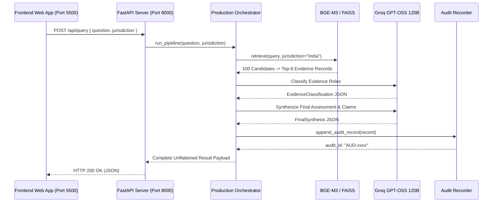

### Verified API Endpoints

* `GET /api/health`: Returns service status and backend operational indicators.
* `GET /api/jurisdictions`: Returns list of supported jurisdiction profiles (`India`, `European Union`).
* `POST /api/query`: Submits query for full 10-stage evidence-grounded analysis.
* `GET /api/scenarios`: Retrieves all 7 pre-configured multi-step operational scenarios.
* `GET /api/scenarios/{scenario_id}`: Retrieves detailed steps for a specific scenario.
* `POST /api/scenarios/run`: Executes an individual step from a simulation scenario.
* `GET /api/audits`: Paginated list of audit records with metrics, filters, and search.
* `GET /api/audits/{audit_id}`: Full unflattened audit record for deep forensic inspection.
* `POST /api/risk/assess`: Standalone endpoint to assess risk on arbitrary decision contexts.

---

## 26. Frontend Architecture

The user interface in `Frontend/index.html` is an institutional investigation console built with responsive Vanilla HTML, CSS, and JavaScript:
* **Query Portal (`#/intelligence`)**: Live question input with jurisdiction selector (IN / EU), real-time backend health monitor, and results dashboard.
* **Evidence Browser**: Displays retrieved snippets with metadata tags (Source Document, Page, Jurisdiction, Retrieval Rank).
* **Scenario Lab (`#/scenarios`)**: Interactive multi-step simulation environment featuring 7 operational incidents.
* **Audit Trail Console (`#/audit`)**: Full forensic investigation ledger featuring aggregate metrics, fast client/server search, multi-factor filtering (Domain, Jurisdiction, Risk, Type), and an in-depth 14-section record inspector with interactive claim-to-evidence anchor linking.
* **Theme System**: High-contrast dark glassmorphism (default) with integrated light theme support and local storage persistence.

---

## 27. Complete Repository Structure

```
HackGrid_new/
├── .env                                  # Local environment configuration (GROQ_API_KEY)
├── .gitignore                             # Git ignore rules for virtualenvs, caches, indices
├── agents.txt                             # Historical prototype reference (Gemini prototype)
├── RUN_HACKGRID_DEV.bat                  # Developer startup script (launches backend & frontend)
├── START_HACKGRID.bat                    # Production demo startup script with health checks
│
├── Backend/                              # Core Python backend architecture
│   ├── server.py                         # FastAPI web application entrypoint
│   ├── orchestrator.py                   # Canonical 10-stage production pipeline
│   ├── final_synthesis.py                # Final GPT-OSS 120B reasoning and synthesis
│   ├── governance.py                     # Deterministic governance normalization layer
│   ├── audit_api.py                      # RESTful controller for the Audit Trail
│   ├── risk_engine_api.py                # RESTful controller for standalone Risk Engine
│   ├── risk_integration.py               # Bridge connecting RAG results to Risk Engine
│   ├── risk_integration_v2.py            # Enhanced risk calculation adapter
│   ├── baseline_manifest.json            # Engineering baseline configuration
│   │
│   ├── audit/                            # Audit subsystem
│   │   ├── models.py                     # Pydantic & dataclass schemas for audit entries
│   │   ├── recorder.py                   # Append-only serialization logic
│   │   └── records/
│   │       └── audit.jsonl               # Immutable audit log (26+ historical records)
│   │
│   ├── benchmarks/                       # Research evaluation suite
│   │   ├── benchmark_questions.json      # 10 gold benchmark questions
│   │   ├── run_benchmark.py              # Automated benchmark execution runner
│   │   ├── evaluation/                   # Metrics calculation and research scorecards
│   │   └── results/                      # Real benchmark evaluation artifacts
│   │
│   ├── demo_scenarios/                   # Pre-configured multi-step operational scenarios
│   │   ├── library.py                    # Scenario catalog (7 multi-step incidents)
│   │   └── models.py                     # Scenario data schemas
│   │
│   ├── evidence_engine/                  # Evidence evaluation subsystem
│   │   ├── engine.py                     # EvidenceEngine sufficiency & strength evaluation
│   │   ├── llm_classifier.py             # GPT-OSS structured evidence role classifier
│   │   ├── absence_protocol.py           # Conservative absence verification protocol
│   │   ├── claim_builder.py              # Bidirectional claim-to-evidence builder
│   │   ├── validator.py                  # Evidence schema consistency validator
│   │   ├── gap_adapter.py                # Gap analysis integration adapter
│   │   ├── models.py                     # Enums for EvidenceStatus, Strength, Role
│   │   └── provenance.py                 # Source chunk provenance tracing
│   │
│   ├── evidence_reranking/               # Reranking & counter-evidence subsystem
│   │   ├── reranker.py                   # BGE Reranker v2-M3 integration
│   │   ├── counter_evidence.py           # Counter-query generation and lexical scoring
│   │   ├── evidence_analyzer.py          # Linguistic role partitioner
│   │   └── models.py                     # Data schemas for reranking outputs
│   │
│   ├── query_analysis/                   # Query understanding subsystem
│   │   ├── domain_classifier.py          # 7-domain and 8-intent classification engine
│   │   ├── models.py                     # QueryClassification dataclass
│   │   └── retrieval_profiles.py         # Domain-specific retrieval tuning
│   │
│   ├── response_profiles/                # Adaptive response formatters
│   │   ├── profiles.py                   # Profile definitions (Executive, Technical, etc.)
│   │   └── formatter.py                  # Markdown response formatter
│   │
│   ├── risk_engine/                      # Deterministic risk & governance subsystem
│   │   ├── engine.py                     # Core RiskEngine calculation class
│   │   ├── rules.py                      # Consequence, uncertainty, and escalation rules
│   │   ├── policy.py                     # Authority escalation hierarchy
│   │   └── models.py                     # RiskLevel, EscalationLevel enums
│   │
│   └── tests/                            # Unit and integration test suite (16 test files)
│
├── Frontend/                             # Single-page web application
│   ├── index.html                        # Complete UI (Query Portal, Scenario Lab, Audit Trail)
│   └── index.html.bak                    # Prior version backup
│
├── knowledge_base/                       # Raw source PDF regulatory & standards repository
│   ├── Documents main/                   # 72 primary documents (3GPP, DoT, TRAI, TEC, EU, ITU)
│   ├── DEFENCE/                          # DRDO ToT Policy, Drone Rules, NATO CONEMP PDFs
│   └── MARITIME/                         # IMO conventions, AIS operational circulars PDFs
│
└── rag/                                  # RAG vector retrieval & specialist agents
    ├── chunks_new.json                   # 14,143 chunk knowledge base (18.1 MB)
    ├── embeddings_new.npy                # 14,143 dense 1024-dim BGE-M3 vectors (57.9 MB)
    ├── faiss_new.index                   # Compiled FAISS IndexFlatIP index (57.9 MB)
    ├── retrieval.py                      # Core BGE-M3 + FAISS retrieval with jurisdiction profiles
    ├── gptoss_backend.py                 # Groq client integration for GPT-OSS 120B
    ├── orchestrator.py                   # Concurrent specialist multi-agent orchestrator
    ├── network_agent.py                  # 5G Network architecture analysis specialist
    ├── compliance_agent.py               # Regulatory compliance specialist
    ├── policy_agent.py                   # Policy & standards landscape specialist
    ├── gap_analysis_agent.py             # Specialist gap analysis synthesizer
    ├── multi_kb_retriever.py             # Multi-index retrieval federation logic
    ├── DEFENCE CHUNKS/                   # Dedicated Defence KB index (in-repo structure)
    └── MARITIME CHUNKS/                  # Dedicated Maritime KB index (in-repo structure)
```

---

## 28. Example End-to-End Case Study

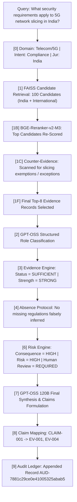

---

## 29. Example Output

A representative sanitized response payload from `POST /api/query`:

```json
{
  "query": "What security requirements apply to 5G network slicing in India?",
  "jurisdiction": "India",
  "domain": "Telecom/5G",
  "intent": "Compliance",
  "evidence_summary": {
    "overall_status": "SUFFICIENT",
    "overall_strength": "STRONG",
    "supporting_count": 6,
    "contradicting_count": 0,
    "missing_evidence": []
  },
  "absence_verification": {
    "verdict": "NOT_APPLICABLE",
    "positive_evidence_found": true
  },
  "gap_analysis": {
    "verdict": "PARTIALLY_COVERED",
    "summary": "Core slicing security covered under MTCTE and Critical Infrastructure Rules 2024; cross-slice isolation verification criteria remain unstandardized."
  },
  "risk_assessment": {
    "risk_level": "CRITICAL",
    "risk_score": 85,
    "escalation_level": "SENIOR_AUTHORITY",
    "human_review_required": true,
    "governance_decision": "MANDATORY_HUMAN_REVIEW"
  },
  "final_synthesis": {
    "assessment": "5G network slicing in India requires adherence to DoT Critical Telecommunications Infrastructure Rules (2024) and TEC Mandatory Testing (MTCTE) standards...",
    "claims": [
      {
        "claim_id": "CLAIM-001",
        "claim": "Dedicated network slice instances must maintain cryptographically isolated management planes.",
        "status": "SUPPORTED",
        "confidence": 0.94,
        "evidence_ids": ["EV-001", "EV-004"]
      }
    ],
    "technical_implications": "Requires deployment of hardware-isolated user plane functions (UPF).",
    "regulatory_implications": "Mandatory audit logs must be maintained for a minimum of 2 years for lawful inspection.",
    "human_review_required": true
  },
  "claim_evidence_mappings": [
    {
      "claim_id": "CLAIM-001",
      "evidence_ids": ["EV-001", "EV-004"]
    }
  ],
  "audit_id": "AUD-7881c29ce0e41005325abab5"
}
```

---

## 30. Use Cases

### Current Implemented Use Cases (Verified)
1. **5G Network Slicing Security Compliance (India)**: Cross-verifying 3GPP Rel 18 architecture against DoT Critical Infrastructure Rules 2024 and TEC GRs.
2. **AIS and GNSS Vessel Behaviour Anomaly Analysis (Maritime)**: Investigating AIS spoofing and spoofing detection under IMO circulars and Indian NOSDCP guidelines.
3. **UAV Tactical Datalink Interference Investigation (Defence)**: Evaluating drone frequency jamming against Drone Rules 2021 and DRDO guidelines.
4. **Telecom OSS/BSS Ransomware Incident Reporting**: Evaluating statutory notification obligations under CERT-In directions and the Telecommunications Act 2023.
5. **Cross-Border 5G Network Function Assessment (EU vs. India)**: Isolating NIS2 Directive and GDPR compliance from Indian DoT mandates.

### Potential / Future Use Cases (Planned)
* Real-time automated regulatory change tracking and index re-synchronization.
* Direct integration into continuous compliance pipelines for maritime vessel traffic management.
* Edge deployment for field-deployed tactical communications compliance.

---

## 31. Domain Mapping

| Domain | Example Query | Primary Evidence Base | Specialist Agent | Output Scope | Governance Escalation |
|---|---|---|---|---|---|
| **Telecom/5G** | Network slice isolation rules | 3GPP TS 23.501, DoT Rules 2024, TEC GRs | Network + Compliance | Isolation mandate | `SENIOR_AUTHORITY` |
| **Maritime** | AIS spoofing reporting protocol | IMO MSC circulars, NOSDCP Circular | Compliance | Navigation safety | `DOMAIN_EXPERT` |
| **Defence** | Tactical datalink band approval | Drone Rules 2021, DRDO ToT 2025 | Network + Policy | Spectrum limits | `SENIOR_AUTHORITY` |
| **Policy** | Personal data retention limits | DPDP Act 2023, IT Act Rules | Compliance + Policy | Retention duties | `ANALYST_REVIEW` |
| **Research** | O-RAN security threat models | ITU-T Y.3172, O-RAN papers | Policy + Gap Agent | Standards vacuum | `AUTO_RESPONSE` |

---

## 32. Why HackGrid Is Different

| Capability | Conventional RAG | Generic Multi-Agent LLMs | HackGrid Decision Intelligence |
|---|---|---|---|
| **Primary Grounding** | Unranked text chunks | Model conversational context | **Verified 14,143-chunk statutory/standards KB** |
| **Jurisdiction Awareness** | None (cross-jurisdiction contamination) | Prompt-guided (unreliable) | **Deterministic profile-gated retrieval filter** |
| **Counter-Evidence** | None (pure similarity bias) | Rare / Ad-hoc | **Active counter-query synthesis & signal scoring** |
| **Absence Handling** | Assumes search miss = non-existence | Hallucinates non-existence | **Conservative `ABSENCE_NOT_ESTABLISHED` protocol** |
| **Evidence Sufficiency** | Unmeasured | Heuristic LLM confidence | **Mathematical sufficiency & strength evaluation** |
| **Risk Escalation** | None | Model self-rating (uncalibrated) | **Deterministic 4-tier risk & authority engine** |
| **Traceability** | Document-level or none | Broad text citations | **Claim-level bidirectional mapping (`CLAIM` → `EV`)** |
| **Auditability** | Ephemeral chat logs | Ephemeral agent history | **Immutable append-only JSONL ledger (`audit.jsonl`)** |

---

## 33. Research Significance

HackGrid serves as an empirical research platform for evaluating evidence-grounded AI decision systems. The platform operationalizes eight fundamental research questions (`Backend/benchmarks/evaluation/RESEARCH_PROTOCOL.md`):
* **RQ1 (Retrieval)**: Precision of dense vector search under strict geographic boundaries.
* **RQ2 (Evidence)**: Linguistic and semantic separation of supporting, contradicting, and limiting evidence.
* **RQ3 (Grounding)**: Verification that 100% of asserted claims possess source chunk lineage.
* **RQ4 (Absence)**: Elimination of false negative statutory conclusions.
* **RQ5 (Gap Analysis)**: Structural distinction between genuine regulatory gaps and corpus omissions.
* **RQ6 (Risk)**: Consequence-aware risk calibration independent of model confidence.
* **RQ7 (Human Oversight)**: Deterministic policy enforcement gating consequential actions.
* **RQ8 (Auditability)**: Full analytical reproducibility from serialized audit artifacts.

---

## 34. Evaluation Framework

### Recommended Evaluation Framework
HackGrid includes an integrated benchmark and scorecard evaluation harness (`Backend/benchmarks/`).

#### Verified Benchmark Results (`research-scorecard-v1`)

```json
{
  "benchmark_version": "hackgrid-benchmark-v1",
  "total_cases": 10,
  "successful_cases": 10,
  "pipeline_success_rate": 1.0,
  "claim_grounding_rate": 1.0,
  "unsupported_claim_rate": 0.0,
  "audit_coverage": 1.0,
  "evidence_status_accuracy": 0.70,
  "human_review_accuracy": 0.80,
  "overall_research_score": 0.75
}
```

* **Claim Grounding Rate**: **1.0 (100%)** — All 20 evaluated claims were strictly grounded in retrieved evidence chunks.
* **Unsupported Claim Rate**: **0.0 (0%)** — Zero ungrounded assertions were produced.
* **Audit Coverage**: **1.0 (100%)** — Every evaluated pipeline execution generated an unflattened, traceable audit record.

---

## 35. Security / Trust Model

1. **No Hardcoded Secrets**: Secrets and API keys are strictly loaded via `.env`. No credentials or keys are committed to Git.
2. **Deterministic Governance Enforcement**: Even if the generative model suggests auto-approval, `Backend/governance.py` enforces mandatory human review for critical cases.
3. **Immutable Audit Persistence**: Audit records are serialized as append-only JSONL entries, preventing retrospective falsification of analysis history.
4. **Air-Gapped Vector Retrieval**: Embeddings and FAISS index queries execute entirely on local compute; only the final redacted evidence payload is transmitted to the Groq API for reasoning.

---

## 36. Limitations

* **Corpus Boundedness**: HackGrid's factual horizon is bounded by its 14,143 indexed chunks. Novel circulars issued after indexing require manual ingestion.
* **Probabilistic Synthesis**: While grounded in evidence, language-model synthesis can exhibit phrasing variance across identical contexts.
* **Domain KB Integration**: The dedicated Defence and Maritime chunk indices exist physically as repository scaffolds but currently fall back to the Main KB in unified live querying.
* **Non-Legal Finality**: HackGrid provides technical and regulatory **decision support**. It does not substitute for qualified legal counsel or statutory government gazettes.

---

## 37. Future Roadmap

```
CURRENT (v1.0 Baseline)
  ├── 14,143-chunk Main Knowledge Base active
  ├── 10-stage production orchestrator with GPT-OSS 120B
  ├── Deterministic Risk Engine & Governance Layer
  └── Interactive Web Console & Forensic Audit Trail

NEAR TERM (v1.1)
  ├── Live compilation and active routing for dedicated Maritime & Defence KB indices
  ├── Hybrid sparse/dense retrieval (BM25 + BGE-M3 reciprocal rank fusion)
  └── Multi-reviewer cryptographic digital signatures on audit entries

RESEARCH (v2.0)
  ├── Temporal knowledge base versioning (tracking amendment histories over time)
  ├── Multilingual statutory retrieval (Hindi, French, German regulatory gazettes)
  └── Automated continuous benchmark regression testing

PRODUCTION (Enterprise)
  ├── Distributed PostgreSQL / pgvector backend persistence
  ├── Multi-tenant role-based access control (RBAC) with SSO integration
  └── Real-time regulatory feed ingestion webhooks
```

---

## 38. Installation

### System Prerequisites
* **Operating System**: Windows 10/11 (PowerShell / Command Prompt) or Linux (Ubuntu 22.04+)
* **Python**: Python 3.10 to 3.13
* **Hardware**: Minimum 8 GB RAM (16 GB recommended for BGE-M3 and FAISS index in memory)

### Step 1: Clone Repository
```powershell
git clone https://github.com/shashankRF/HackGrid--An-Evidence-Grounded-Jurisdiction-Aware-Multi-Agent-Framework-.git
cd HackGrid--An-Evidence-Grounded-Jurisdiction-Aware-Multi-Agent-Framework-
```

### Step 2: Set Up Python Virtual Environment
```powershell
python -m venv .venv
.\.venv\Scripts\Activate.ps1
```

### Step 3: Install Dependencies
```powershell
pip install --upgrade pip
pip install fastapi uvicorn pydantic python-dotenv groq faiss-cpu sentence-transformers FlagEmbedding numpy pytest
```

---

## 39. Configuration

Create a `.env` file in the repository root:

```ini
# Groq API Key for GPT-OSS 120B inference
GROQ_API_KEY=your_groq_api_key_here

# Optional: Host & Port configurations
HACKGRID_HOST=127.0.0.1
HACKGRID_PORT=8000
```

> [!WARNING]
> Never commit your `.env` file or expose your `GROQ_API_KEY`.

---

## 40. Running HackGrid

### Quick Start (Windows)
Run the automated launch script:
```powershell
.\START_HACKGRID.bat
```
This script checks the virtual environment, verifies the Groq API key, starts the FastAPI backend on port 8000, starts the web frontend on port 5500, polls `/api/health` until ready, and automatically opens your browser to `http://127.0.0.1:5500`.

### Manual Startup

#### Terminal 1 — Start Backend Server (Port 8000)
```powershell
.\.venv\Scripts\Activate.ps1
python -m uvicorn Backend.server:app --host 127.0.0.1 --port 8000 --reload
```

#### Terminal 2 — Start Frontend Server (Port 5500)
```powershell
.\.venv\Scripts\Activate.ps1
python -m http.server 5500 --bind 127.0.0.1 --directory Frontend
```

#### Terminal 3 — Execute Standalone Pipeline Test
```powershell
.\.venv\Scripts\Activate.ps1
python -m Backend.orchestrator
```

---

## 41. API Example

### Query Submission (`POST /api/query`)

```powershell
curl -X POST "http://127.0.0.1:8000/api/query" `
  -H "Content-Type: application/json" `
  -d '{"question": "What security requirements apply to 5G network slicing in India?", "jurisdiction": "India"}'
```

---

## 42. Reproducibility

To reproduce HackGrid's exact findings:
1. Ensure the canonical 14,143-chunk index artifacts are present in `rag/`:
   * `chunks_new.json` (SHA256 verified)
   * `embeddings_new.npy` (Dense 1,024-dim BGE-M3 matrix)
   * `faiss_new.index` (Inner product index)
2. Use Python 3.10+ with `sentence-transformers==6.1.0` and `faiss-cpu==1.15.1`.
3. Set `temperature=0.2` in `Backend/final_synthesis.py` and `rag/gptoss_backend.py`.
4. Run the automated evaluation scorecard:
   ```powershell
   python Backend/benchmarks/run_benchmark.py
   ```

---

## 43. Responsible AI & Institutional Safety

HackGrid is explicitly designed as a **decision-support framework**, not an autonomous administrative authority.
* **No Unilateral Executive Action**: HackGrid outputs cannot trigger automated legal filings, license revocations, or critical network modifications.
* **Mandatory Human-in-the-Loop**: All outputs classified with High or Critical risk mandate authenticated human sign-off (`SENIOR_AUTHORITY`).
* **Preservation of Uncertainty**: When evidence is incomplete or ambiguous, HackGrid explicitly surfaces the conflict rather than forcing synthetic consensus.

---

## 44. Current Implementation Status

| Capability / Module | Status | Verification Notes |
|---|---|---|
| **Main RAG Knowledge Base** | ✅ **Implemented** | 14,143 chunks fully indexed in FAISS (`faiss_new.index`) |
| **BGE-M3 Dense Embeddings** | ✅ **Implemented** | Normalized 1,024-dim representations in `rag/retrieval.py` |
| **Jurisdiction Gating (IN / EU)** | ✅ **Implemented** | Profile filtering active in `rag/retrieval.py` |
| **Counter-Evidence Retrieval** | ✅ **Implemented** | Lexical query transformation in `counter_evidence.py` |
| **Cross-Encoder Reranking** | ✅ **Implemented** | `bge-reranker-v2-m3` in `reranker.py` with similarity fallback |
| **Evidence Role Classification** | ✅ **Implemented** | Supporting / Contradicting / Contextual partitioning active |
| **EvidenceEngine Sufficiency** | ✅ **Implemented** | Deterministic mathematical sufficiency in `engine.py` |
| **Conservative Absence Protocol** | ✅ **Implemented** | `ABSENCE_NOT_ESTABLISHED` safeguard in `absence_protocol.py` |
| **Deterministic Risk Engine** | ✅ **Implemented** | 4-tier escalation model in `Backend/risk_engine/` |
| **Specialist Multi-Agent System** | ✅ **Implemented** | Parallel execution via `ThreadPoolExecutor` in `rag/orchestrator.py` |
| **GPT-OSS 120B Final Synthesis** | ✅ **Implemented** | Production synthesis via Groq API in `final_synthesis.py` |
| **Claim → Evidence Mapping** | ✅ **Implemented** | Bidirectional trace mapping in `claim_builder.py` |
| **Append-Only Audit Trail** | ✅ **Implemented** | Persistent JSONL serialization in `Backend/audit/recorder.py` |
| **Scenario Lab (7 Incidents)** | ✅ **Implemented** | 7 multi-step simulation scenarios in `demo_scenarios/library.py` |
| **Web Console & Audit UI** | ✅ **Implemented** | Forensic single-page application in `Frontend/index.html` |
| **Dedicated Maritime KB Index** | 🟡 **Experimental** | Physical directory scaffold present; falls back to Main KB |
| **Dedicated Defence KB Index** | 🟡 **Experimental** | Physical directory scaffold present; falls back to Main KB |
| **Automated Regulatory Ingestion**| 🔵 **Planned** | Webhook-driven statutory gazette re-indexing scheduled for v2.0 |

---

## 45. Citation / Research Use

If you utilize HackGrid's architecture, evidence engine, or benchmark protocols in your research, please cite this project:

```bibtex
@misc{hackgrid2026,
  author = {Shashank Kotnala and Contributors},
  title = {HackGrid: An Evidence-Grounded Jurisdiction-Aware Multi-Agent Framework},
  year = {2026},
  publisher = {GitHub},
  howpublished = {https://github.com/shashankRF/HackGrid--An-Evidence-Grounded-Jurisdiction-Aware-Multi-Agent-Framework-},
  note = {Citation information will be updated upon publication of the associated research paper.}
}
```

---

## 46. Contributing

Contributions are welcomed in the areas of statutory corpus expansion, retrieval benchmarks, and formal governance rules.
1. Fork the repository and create a descriptive feature branch (`git checkout -b feature/maritime-index`).
2. Ensure all changes adhere strictly to HackGrid's **evidence-first invariant** (no ungrounded assertions or silent risk reduction).
3. Run the verification test suite before committing:
   ```powershell
   pytest Backend/tests/
   ```
4. Open a pull request with complete provenance documentation.

---

## 47. License

*No license has currently been specified.* All rights are reserved by the original project authors. Consult the repository maintainers for permission to reuse or redistribute.

---

## 48. Acknowledgements

HackGrid relies upon and gratefully acknowledges:
* **The 3GPP and ETSI Technical Specifications Groups** for foundational 5G and security architecture standards.
* **The Department of Telecommunications (DoT), Telecom Regulatory Authority of India (TRAI), and Telecommunication Engineering Centre (TEC)** for open statutory and technical guidelines.
* **The European Commission** for open publication of the NIS2 Directive, GDPR, and the EU Artificial Intelligence Act.
* **Beijing Academy of Artificial Intelligence (BAAI)** for the `bge-m3` embedding and `bge-reranker-v2-m3` models.
* **Groq** for high-throughput LPU inference enabling real-time reasoning with `openai/gpt-oss-120b`.
* **Meta / OpenAI OSS** for foundational open-weights generative language models.

---

## 49. Legacy / Deprecated Components

During early system prototyping, an initial experimental implementation utilized Google's Gemini SDK (`gemini-3-flash-preview` / `google.genai`). 
* **Location in Repository**: Stored strictly for reference in `agents.txt`.
* **Current Operational Status**: **DEPRECATED & INACTIVE**. The active production HackGrid framework operates exclusively on the Groq-hosted `openai/gpt-oss-120b` reasoning engine and `BAAI/bge-m3` vector pipeline documented above. No live backend modules invoke or depend upon the legacy Gemini prototype.
